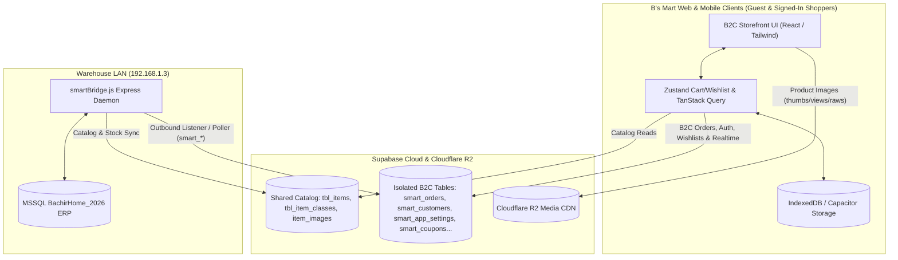

# System Architecture: B's Mart (B2C) Next.js + Capacitor & Supabase/MSSQL Sync

This skill documents the full-stack architecture and synchronization flow for **B's Mart** between the Next.js/Capacitor consumer application, Supabase Cloud, Cloudflare R2, and the on-premise warehouse ERP (`smartBridge.js` + MSSQL `BachirHome_2026`).

---

## 1. Architecture Overview

B's Mart uses a cross-platform, air-gapped Cloud Mailbox architecture:
- **Consumer Client Application**: Next.js (React, Tailwind CSS) providing a fast, SEO-friendly B2C web storefront and packaged as native Android & iOS mobile shopping apps via **Capacitor**.
- **Media CDN (Cloudflare R2)**: High-speed global edge CDN serving product image tiers (`thumbs/`, `views/`, `raws/`), shared with the central catalog.
- **Cloud Mailbox (Supabase Cloud)**: Shared PostgreSQL project (`https://nhellhapzcylcukdxcwo.supabase.co`) with strict namespace separation:
  - **Shared Catalog Read Tables**: `tbl_items`, `tbl_item_classes`, `item_images`.
  - **Isolated B's Mart B2C Tables (`smart_*`)**: `smart_orders`, `smart_order_items`, `smart_users`, `smart_customers`, `smart_app_settings`, `smart_coupons`, `smart_wishlists`, `smart_reviews`, `smart_banners`, and `smart_task_queue`.
- **Dedicated On-Premise Warehouse Daemon (`smartBridge.js`)**: Runs inside the warehouse LAN (`192.168.1.3`), blueprints stored at `reference/smartBridge.js`. Maintains an outbound connection to Supabase Cloud, pulls `Pending` B2C orders from `smart_orders` and jobs from `smart_task_queue`, executes stored procedures against MSSQL (`BachirHome_2026`), and pushes order tracking statuses back to Supabase.
- **MSSQL Database (`BachirHome_2026`)**: The central warehouse transactional database of record.

---

## 2. Key Sync & Commerce Flows

### A. Zero Direct LAN Access (Cloud Mailbox Pattern)
- Consumer browsers and mobile devices connect **only** to public internet endpoints (Supabase Cloud and Cloudflare R2).
- Clients **never** make direct HTTP calls to `192.168.1.3:8090`. All operations are mediated through Supabase tables.

### B. B2C Order Submission & Ingestion Pipeline (Guest & Registered)
1. **Consumer Checkout**: Basem validates the checkout form (Guest contact/address or Registered Customer address), calculates retail sale discounts, applies any `smart_coupons` promo code, adds the delivery zone fee (or $0 if above the free-shipping threshold), and Deebeh inserts the order into `public.smart_orders` and `public.smart_order_items` with status `"Pending"`.
2. **Bridge Ingestion**: The on-premise `smartBridge.js` daemon detects the new `"Pending"` row in `public.smart_orders` via an outbound listener/poller.
3. **ERP Transaction**: `smartBridge.js` maps the B2C customer/guest details and line items into the MSSQL warehouse database (`BachirHome_2026`).
4. **Status Confirmation & Delivery Tracking**: Upon ERP confirmation, `smartBridge.js` updates `public.smart_orders.status` (`"Confirmed"`, `"Out for Delivery"`, `"Delivered"`).
5. **Realtime Notification**: Supabase Realtime updates the shopper's live order tracking page in real time.

### C. B2C Task Queue (`smart_task_queue`)
For asynchronous operations requiring direct MSSQL interaction (e.g. account deletion requests, loyalty/customer ledger lookups, or custom ERP validations):
- **Enqueue**: Client inserts a task payload into `public.smart_task_queue`.
- **Backend Runner**: `smartBridge.js` picks up the task, executes against MSSQL (`BachirHome_2026`), and writes the result and `"completed"` / `"error"` status back to `smart_task_queue`.

### D. Resilient Local Persistence
- **Guest & Offline Persistence**: Cart items, applied coupon codes, recently viewed items, and wishlists are persisted in IndexedDB / `localStorage` / Capacitor Preferences so shoppers never lose their basket across app restarts or brief network drops.
